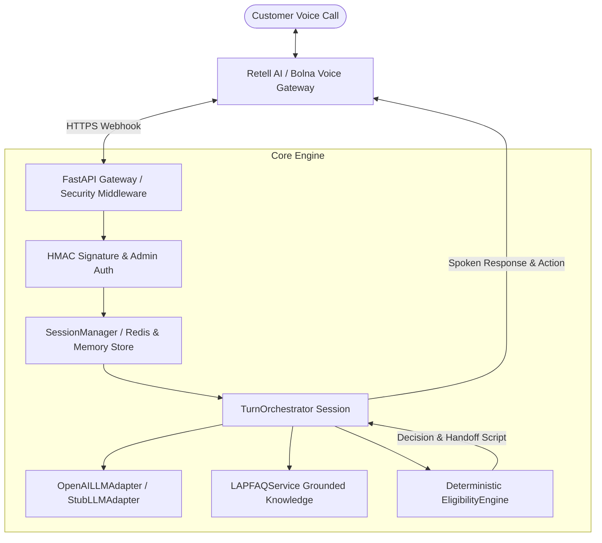
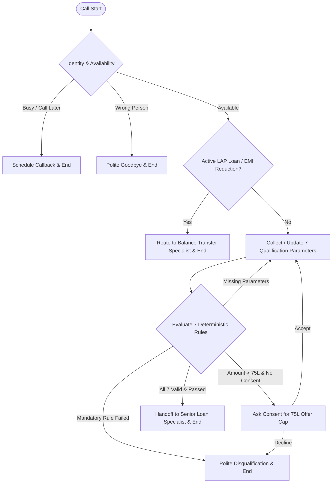

# CredVoice — Home Credit LAP Qualification Voice Agent

**CredVoice** is an enterprise-grade AI-powered conversational voice agent backend designed for Home Credit India to qualify existing pre-approved customers for a **Loan Against Property (LAP)** offer of up to **₹75 Lakh**.

---

## Architecture & System Flow Diagrams

### High-Level Architecture Diagram



### Conversation & Eligibility Flow Diagram



---

## Key Features & Production Protections

- **Deterministic Eligibility Engine (`app/services/eligibility.py`)**: 7 mandatory rules (Property Type, Ownership, Original Documents, Loan Amount ≤ ₹75L, Bank Income Mode, Property Market Value, Tenure 3–15 Years). Python logic is the sole authority; LLMs cannot override business rules.
- **Immediate Disqualification & Transfer Routing**: Instantly halts qualification upon mandatory rule failure or routes balance transfer / EMI reduction requests directly to specialists.
- **Dual Voice Platform Support (Retell AI & Bolna)**: Complete webhook lifecycles (`/api/v1/webhooks/retell` and `/api/v1/webhooks/bolna`) supporting HMAC SHA256 signature verification, idempotency deduplication (`event_id`), and provider-specific response formatting.
- **Multi-Worker Redis State Manager (`app/services/session_manager.py`)**: Shared state across container instances via `RedisSessionStore` with graceful fallback to `InMemorySessionStore`.
- **Grounded LAP Knowledge Service (`app/services/knowledge.py`)**: FAQ retrieval from `knowledge/lap_faq.json` without hallucinating interest rates or approval guarantees.
- **Production Hardening & PII Protection**: PII redaction (`app/utils/logging.py`), Admin API key auth (`x-api-key`) on inspection endpoints, payload size limiting (1MB), correlation ID tracking (`x-correlation-id`), and `/readiness` probe.

---

## Environment Setup & Configuration

### 1. Prerequisites
- Python 3.10+
- Redis (Optional, for multi-worker production deployments)
- Docker & Docker Compose (Optional, for containerized execution)

### 2. Environment Variables (.env)

Copy `.env.example` to `.env`:

```bash
cp .env.example .env
```

```env
# Application Settings
APP_ENV=development
SERVICE_NAME=CredVoice
LOG_LEVEL=INFO

# LLM Provider Configuration
LLM_PROVIDER=openai
LLM_MODEL=gpt-4o-mini
OPENAI_API_KEY=your_openai_api_key_here
RUN_LIVE_LLM_TESTS=false

# Voice Platform Integrations
VOICE_PROVIDER=retell
RETELL_API_KEY=your_retell_api_key_here
RETELL_WEBHOOK_SECRET=your_retell_webhook_secret_here
BOLNA_API_KEY=your_bolna_api_key_here
BOLNA_WEBHOOK_SECRET=your_bolna_webhook_secret_here
PUBLIC_WEBHOOK_BASE_URL=http://localhost:8000
SESSION_TTL_SECONDS=3600
VERIFY_WEBHOOK_SIGNATURES=false

# Security & Multi-Worker Production Config
ADMIN_API_KEY=your_admin_api_key_here
CORS_ORIGINS=["*"]
MAX_REQUEST_BODY_BYTES=1048576
SESSION_STORE_TYPE=memory
REDIS_URL=

# Language & Product Knowledge Config
DEFAULT_LANGUAGE=en
SUPPORTED_LANGUAGES=["en", "hi"]
ENABLE_RAG=true
KNOWLEDGE_BASE_PATH=knowledge/lap_faq.json
```

---

## Local Startup & Docker Run

### Option A: Local Python Environment

```bash
# 1. Install dependencies
pip install -r requirements.txt

# 2. Run application
uvicorn app.main:app --reload --host 0.0.0.0 --port 8000
```

### Option B: Docker Compose (App + Redis)

```bash
docker-compose up --build
```

---

## Webhook Configuration & Manual Live Sandbox Testing

> **Note on Verification**: Standard automated test runs (`pytest tests/ -v`) use mocked provider events and `StubLLMAdapter` — incurring **zero network cost or API charges**. Live sandbox calls require explicit configuration as detailed below.

### Webhook URLs
- **Retell AI**: `POST https://<your-domain>/api/v1/webhooks/retell`
- **Bolna**: `POST https://<your-domain>/api/v1/webhooks/bolna`

### Manual Steps for Live Sandbox Call
1. Start local server: `uvicorn app.main:app --port 8000`
2. Expose endpoint via ngrok: `ngrok http 8000`
3. Configure webhook URL in provider console (e.g. `https://abc1234.ngrok-free.app/api/v1/webhooks/retell`).
4. Set `.env` variables: `VERIFY_WEBHOOK_SIGNATURES=true`, `RETELL_WEBHOOK_SECRET=...`, `OPENAI_API_KEY=sk-...`.
5. Initiate test call via provider sandbox console or telephony number.

### Running Opt-In Live Sandbox Tests

```bash
# In PowerShell:
$env:RUN_LIVE_SANDBOX_TESTS="true"
$env:OPENAI_API_KEY="sk-proj-..."
python -m pytest tests/integration/test_live_sandbox.py -v
```

---

## API Reference Summary

| Endpoint | Method | Security | Description |
| :--- | :--- | :--- | :--- |
| `/health` | `GET` | Public | Liveness probe (returns status & version) |
| `/readiness` | `GET` | Public | Readiness probe (checks KB & Redis connection) |
| `/api/v1/webhooks/retell` | `POST` | HMAC Signature | Retell AI event webhook handler |
| `/api/v1/webhooks/bolna` | `POST` | HMAC Signature | Bolna event webhook handler |
| `/api/v1/webhooks/turn` | `POST` | Optional | Direct text turn simulation endpoint |
| `/api/v1/calls/{call_id}` | `GET` | `x-api-key` Admin | Inspect active call state & history |
| `/api/v1/calls/{call_id}` | `DELETE` | `x-api-key` Admin | Terminate call session manually |

---

## Transcripts & Demo Scripts

### Sample English Transcript (Eligible Path)
- **Agent**: "Hello Priya! Is this Priya Sharma? Am I speaking to the right person?"
- **User**: "Yes, this is Priya Sharma. I can talk now."
- **Agent**: "Great! What type of property do you own and what loan amount do you need?"
- **User**: "I have a residential house in Delhi, sole ownership, original docs available. Looking for 50 Lakhs loan, salaried bank income, value 1.2 Crore, 10 years tenure."
- **Agent**: "Congratulations Priya! You qualify for CredVoice LAP. Transferring you to our loan specialist."

### Sample Hindi / Hinglish Transcript (Agricultural Disqualification)
- **Agent**: "नमस्ते Ramesh ji! क्या आप अपने प्रॉपर्टी लोन के बारे में बात कर सकते हैं?"
- **User**: "हाँ, मेरी पंजाब में कृषि भूमि (agricultural land) है, क्या उस पर लोन मिलेगा?"
- **Agent**: "धन्यवाद Ramesh ji. क्षमा करें, CredVoice पर केवल आवासीय, व्यावसायिक या औद्योगिक संपत्ति (residential, commercial, industrial) ही पात्र है। कृषि भूमि पात्र नहीं है। धन्यवाद!"

---

## Automated Test Suite & Report

Run full test suite:
```bash
python -m pytest tests/ -v
```

### Actual Verification Results
- **Total Test Cases**: 114
- **Passed**: 111
- **Skipped**: 3 (Opt-in live sandbox integration tests)
- **Failed**: 0
- **Coverage**: Core Eligibility Engine, Session Manager, Turn Orchestrator, LLM Adapter & Exceptions, Security & Auth, Webhooks, FAQ Knowledge Base, and 20 E2E Scenario Tests.

---

## Known Limitations & Production Handoff Notes

1. **Voice Telephony Sandbox**: Live phone calls require an active Retell/Bolna subscription and public HTTPS forwarding (e.g. ngrok or cloud hosting).
2. **Speech-to-Text Accents**: Indian English accents and complex mixed Hinglish vocabulary depend on the voice gateway's STT model settings.
3. **Session Store Scaling**: Defaults to `InMemorySessionStore` for single-instance deployments; set `SESSION_STORE_TYPE=redis` for horizontal scaling across Kubernetes or container instances.

---

## Final Assignment Checklist

- [x] **Deterministic Eligibility Engine**: Sole authority on qualification rules; LLM cannot override.
- [x] **7 Mandatory Qualification Criteria**: Property type, ownership, original documents, ₹75L cap consent, bank income mode, market value, tenure 3–15 years.
- [x] **Disqualification & Transfer Routing**: Immediate disqualification on rule failure; transfer routing for existing loans & EMI reduction.
- [x] **Voice Gateway Integrations**: Complete Retell AI and Bolna webhook event handlers.
- [x] **Security Hardening**: HMAC fail-closed verification, PII redaction, Admin API key auth, 1MB body limit, correlation ID.
- [x] **Full E2E Test Suite**: 20 scenario tests, zero failure rate, opt-in live sandbox tests.
