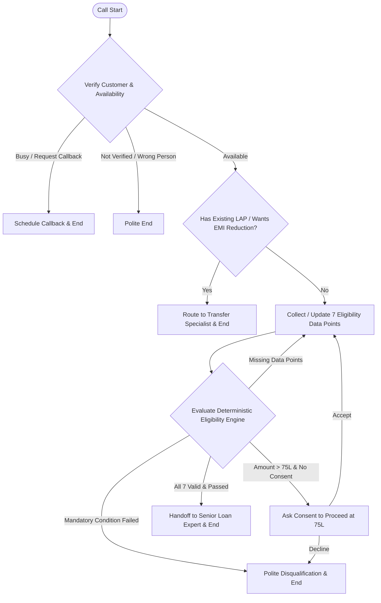
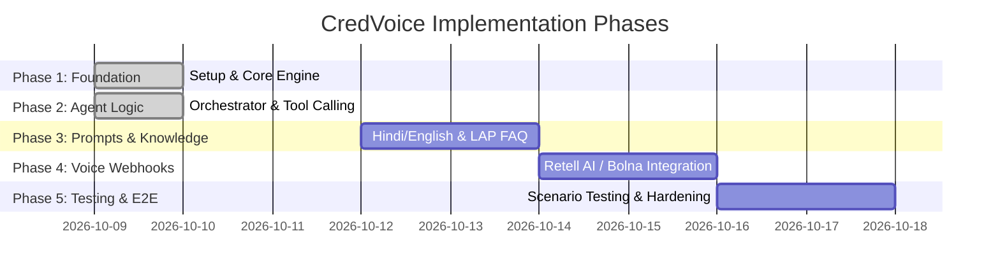

# CredVoice — Home Credit LAP Qualification Voice Agent
## Master Architectural Plan & Project Roadmap

---

## 1. Project Overview & Assignment Objectives

**CredVoice** is an AI-powered conversational voice agent designed for Home Credit India to qualify existing pre-approved customers for a **Loan Against Property (LAP)** offer of up to **₹75 Lakh**.

### Primary Objectives
- Engage pre-approved Home Credit customers in natural, polite, and professional voice conversations in **English** and **Hindi**.
- Verify customer identity and check availability before proceeding with qualification.
- Schedule callbacks when customers are busy or request a call at a later time.
- Collect **7 required eligibility data points** (handling out-of-order responses, corrections, and preventing repetitive questions).
- Perform **immediate disqualification** upon failure of any mandatory eligibility condition.
- Detect **existing property loan / EMI reduction intent** and route the customer to a **Loan-Transfer Specialist**.
- Handoff fully qualified leads to a **Senior Loan Expert** only after all 7 data points are validated and rules pass.
- Provide clear grounding in approved Home Credit LAP product information.
- Integrate cleanly with voice platforms (Retell AI or Bolna) with full logging, call recordings, transcript storage, and automated testing.

---

## 2. Scope & Explicit Non-Goals

### In-Scope (Phase 1 to Phase 5)
- Deterministic eligibility evaluation engine in Python/FastAPI.
- State management for conversation turns, data collection, and routing.
- LLM system prompts for English & Hindi with turn-by-turn state extraction and response generation.
- Dynamic tool/function calling for state updates, qualification checks, callback scheduling, transfer routing, and handoffs.
- Minimal grounded product knowledge base (RAG / structured context) for LAP query answering.
- Voice platform webhooks and session handlers (Retell AI / Bolna).
- Call transcript logging, audio recording link storage, and structured outcome tracking.
- Test suite (Unit, Integration, Conversation state, and E2E simulation).

### Explicit Non-Goals
- Credit bureau pull / CIBIL scoring (pre-approved customer context assumed).
- Final loan underwriting, sanctioning, or binding loan agreements via voice.
- Direct automated disbursal of loan amounts.
- Multi-tenant SaaS user management or customer web portals.
- Custom speech-to-text (STT) or text-to-speech (TTS) model training from scratch (leveraging Retell/Bolna integrations).

---

## 3. Requirements

### Functional Requirements
1. **Verification & Availability**: Confirm customer identity and ask if now is a good time to speak.
2. **Callback Handling**: Capture preferred date/time and callback number when customer is busy.
3. **Bilingual Support**: Smoothly handle English and Hindi conversations, maintaining language throughout or switching on request.
4. **Out-of-Order Data Collection**: Accept eligibility answers in any order. Extract multiple answers from a single turn if provided.
5. **Answer Correction**: Update previously answered fields if customer corrects themselves (e.g., "Actually, my income is bank transfer, not cash").
6. **7 Eligibility Criteria Evaluation**:
   - **Property Type**: Residential, Commercial, Industrial allowed. Agricultural = **Disqualified**.
   - **Ownership**: Sole or Joint ownership allowed.
   - **Original Documents**: Must be available = **True**. Unavailable = **Disqualified**.
   - **Loan Amount**: Cap = ₹75,000,000 (₹75 Lakh). If request > ₹75L, explain limit and seek explicit consent (`proceeds_at_cap`). If declined = **Disqualified/Declined**.
   - **Occupation & Income Mode**: Salaried or Self-Employed allowed. Income mode MUST be `bank` (bank transfer/cheque/online). Cash-only = **Disqualified**.
   - **Property Market Value**: Record customer's estimated value (> 0). No minimum value threshold.
   - **Tenure**: 3 to 15 years inclusive ($3 \le tenure \le 15$). Outside range = **Disqualified**.
7. **Immediate Disqualification**: Stop asking qualification questions immediately once a disqualifying rule fails; explain reason politely and end call.
8. **Transfer Routing**: Route customers with existing property loans or EMI reduction requests to `TRANSFER_SPECIALIST`.
9. **Senior Expert Handoff**: Route to `SENIOR_EXPERT` only when all 7 fields are present and eligibility passes.
10. **Grounded Product Info**: Answer LAP queries (interest range concept, processing fees, document list) using approved context. Do not fabricate rates or policies.

### Non-Functional Requirements
- **Latency**: Voice response generation under 1.2s round-trip delay.
- **Determinism**: Zero LLM hallucination for eligibility rules — business rules enforced strictly in Python.
- **Reliability**: Graceful fallback and error recovery during websocket or LLM failures.
- **Security & Privacy**: Mask PII in logs; keep credentials in environment variables (`.env`).
- **Auditability**: Store full conversation turn logs, transcripts, and final structured outcomes.

---

## 4. Architecture & Component Responsibilities

```text
                        ┌──────────────────────────────────┐
                        │   Voice Platform (Retell/Bolna)  │
                        └────────────────┬─────────────────┘
                                         │ WebSocket / Webhook
                                         ▼
                        ┌──────────────────────────────────┐
                        │     FastAPI Gateway (app/main)   │
                        └────────────────┬─────────────────┘
                                         │
                 ┌───────────────────────┼───────────────────────┐
                 ▼                       ▼                       ▼
    ┌────────────────────────┐ ┌──────────────────┐ ┌────────────────────────┐
    │  Agent Orchestrator    │ │  Eligibility     │ │ Product Knowledge      │
    │  (app/agent/core.py)   │ │  Engine          │ │ Engine                 │
    │  - Turn management     │ │  (app/services/  │ │ (app/services/         │
    │  - Tool execution      │ │   eligibility)   │ │  knowledge.py)         │
    └──┬─────────────────────┘ └──────────────────┘ └────────────────────────┘
       │
       ▼
┌────────────────────────┐
│ State Store            │
│ (app/models/           │
│  conversation.py)      │
└────────────────────────┘
```

### Component Breakdown
1. **API Gateway (`app/main.py`)**: Entry point exposing `/health`, voice platform webhooks, call control endpoints, and transcript query APIs.
2. **Configuration (`app/config.py`)**: Centralized Pydantic settings loading environment variables.
3. **Data Models (`app/models/conversation.py`)**: Enums, state schemas, and payload models for qualification state, turn history, and transfer outcomes.
4. **Eligibility Engine (`app/services/eligibility.py`)**: Pure deterministic Python logic evaluating the 7 qualification rules, returning structured eligibility status (`ELIGIBLE`, `DISQUALIFIED`, `INCOMPLETE`, `TRANSFER_ROUTED`).
5. **Agent Orchestrator (`app/agent/core.py`)**: Manages conversation history, interfaces with LLM (OpenAI / Claude / Gemini), handles tool calls, updates conversation state, and formats voice responses.
6. **Integrations (`app/integrations/`)**: Connectors for Retell AI / Bolna webhooks, STT/TTS settings, and transcript logging.

---

## 5. Technology Stack & Rationale

- **Programming Language**: Python 3.10+ (Robust ecosystem for AI agent backends, FastAPI, Pydantic).
- **Web Framework**: FastAPI (Asynchronous, high-performance API development, OpenAPI auto-generation).
- **Data Validation & Settings**: Pydantic v2 & Pydantic-Settings (Type safety, fast serialization, clean settings management).
- **Testing Framework**: Pytest + Pytest-Asyncio + HTTPX TestClient (Comprehensive unit and integration testing).
- **Voice Platform**: Retell AI / Bolna (Industry standards for low-latency webhooks/websockets, turn-taking, and call recordings).
- **LLM Provider Integration**: LiteLLM / LangChain / OpenAI SDK (Flexible model routing between GPT-4o-mini / Gemini / Claude).

---

## 6. Repository Structure

```text
credvoice/
├── planning.md                # Master plan and roadmap (this file)
├── README.md                  # Setup, run, and testing instructions
├── .env.example               # Environment variable templates
├── .gitignore                 # Version control exclusions
├── requirements.txt           # Project dependencies
├── app/
│   ├── __init__.py
│   ├── main.py                # FastAPI entry point & routes
│   ├── config.py              # Centralized configuration settings
│   ├── models/
│   │   ├── __init__.py
│   │   └── conversation.py    # Pydantic state models & enums
│   ├── services/
│   │   ├── __init__.py
│   │   ├── eligibility.py     # Deterministic 7-rule engine
│   │   └── knowledge.py       # LAP RAG / product QA service
│   ├── api/
│   │   ├── __init__.py
│   │   ├── webhooks.py        # Voice platform webhook endpoints
│   │   └── calls.py           # Call management and transcript API
│   ├── agent/
│   │   ├── __init__.py
│   │   ├── core.py            # Turn orchestrator & tool handler
│   │   └── prompt_builder.py  # System prompts & state injection
│   └── integrations/
│       ├── __init__.py
│       ├── retell.py          # Retell AI webhook / payload handler
│       └── bolna.py           # Bolna webhook handler
├── tests/
│   ├── __init__.py
│   ├── unit/
│   │   ├── __init__.py
│   │   └── test_eligibility.py # Unit tests for eligibility engine
│   ├── integration/
│   │   ├── __init__.py
│   │   └── test_health.py      # Integration tests for API endpoints
│   └── conversation/
│       ├── __init__.py
│       └── test_scenarios.py   # Multi-turn conversation simulation tests
├── prompts/
│   ├── system_en.txt          # English system prompt template
│   └── system_hi.txt          # Hindi system prompt template
├── knowledge/
│   └── lap_faq.json           # Approved LAP product information
└── logs/                      # Local call transcripts & execution logs
```

---

## 7. Conversation Flow & Qualification State Model

### State Diagram



---

## 8. Eligibility Rules & Immediate Disqualification Matrix

| Rule # | Qualification Parameter | Permitted Values / Logic | Disqualification Criteria |
| :--- | :--- | :--- | :--- |
| 1 | **Property Type** | Residential, Commercial, Industrial | Agricultural property |
| 2 | **Ownership** | Sole, Joint | Neither / Unclear ownership |
| 3 | **Original Documents** | Available (`True`) | Missing / Unavailable (`False`) |
| 4 | **Loan Amount** | $\le$ ₹75,000,000 (₹75 Lakh) | Request > ₹75L AND customer declines cap consent |
| 5 | **Income Mode** | Bank transfer / Cheque / Online (`bank`) | Cash-only income (`cash`) |
| 6 | **Property Market Value** | Estimated value $> 0$ | No minimum threshold enforced |
| 7 | **Tenure** | $3 \le \text{Tenure} \le 15$ years | $< 3$ years or $> 15$ years |

---

## 9. Transfer Routing & Callbacks

### Existing Loan Transfer Routing
- Triggered immediately if the customer mentions having an active property loan with another bank or expressing intent to reduce current LAP EMIs.
- Routing Action: Mark state `stage = Stage.TRANSFER_ROUTED`, set `is_transfer_lead = True`, output transfer handoff script, terminate qualification loop.

### Callback Scheduling
- Triggered when customer indicates they are busy, driving, or request a call back later.
- Collect: `preferred_callback_time` and confirm contact number.
- Routing Action: Mark state `stage = Stage.CALLBACK_REQUESTED`, log callback record, politely end call.

---

## 10. LLM Prompt Strategy & Language Handling

- **Dual System Prompts**: Grounded prompts in `prompts/system_en.txt` (English) and `prompts/system_hi.txt` (Hindi).
- **State Injection**: Every LLM turn receives current `QualificationState` injected as JSON context so the model knows remaining missing fields and prevents asking answered questions.
- **Structured Tool Calling**: The LLM executes state update function `update_qualification_state(...)` to parse user responses, update collected fields, and trigger deterministic rules.

---

## 11. Product Knowledge / RAG Strategy

- A lightweight JSON/Markdown grounded knowledge base (`knowledge/lap_faq.json`) containing Home Credit LAP details:
  - Offer cap: ₹75 Lakh.
  - Property types: Residential, Commercial, Industrial.
  - Multi-purpose use: Business expansion, debt consolidation, education, medical, home renovation.
- The agent queries this knowledge base when the customer asks product FAQs without breaking qualification state flow.

---

## 12. Voice Platform Integration Plan

- Integration targets: **Retell AI** or **Bolna**.
- Webhook endpoints:
  - `/api/v1/webhooks/retell`: Handles event triggers `call_started`, `turn_completion`, `call_ended`.
  - `/api/v1/webhooks/bolna`: Handles Bolna event triggers and payload mapping.
- Audio Recordings & Transcripts: Webhook payload extracts `recording_url`, `transcript`, `call_duration`, storing them under `logs/` or database records.

---

## 13. Milestones & Implementation Phases



### Phase Breakdown

#### Phase 1: Foundation & Core Eligibility Engine (COMPLETED)
- **Objective**: Create clean repository structure, configuration, data models, deterministic eligibility service, base API, and unit tests.
- **Deliverables**: `planning.md`, `app/main.py`, `app/config.py`, `app/models/conversation.py`, `app/services/eligibility.py`, `README.md`, `.env.example`, `.gitignore`, `requirements.txt`, unit and integration tests (`tests/unit/test_eligibility.py`, `tests/integration/test_health.py`).
- **Tests**: Health check passing, 10 eligibility rule unit test cases passing.
- **Completion Criteria**: Pytest runs cleanly with 100% pass rate.

#### Phase 2: Agent Orchestration & State Tracking (COMPLETED)
- **Objective**: Implement multi-turn conversation manager and LLM structured-extraction state parser.
- **Deliverables**: `app/agent/core.py` (TurnOrchestrator, StubLLMAdapter, LLMAdapter), `app/agent/prompt_builder.py` (state-aware system prompts, extraction schema, JSON parser), `tests/conversation/test_scenarios.py` (17 scenario tests).
- **Completion Criteria**: 17 multi-turn scenario tests pass; 30/30 total tests pass.

#### Phase 3: Prompts, Language & Knowledge Grounding (COMPLETED)
- **Objective**: Craft English/Hindi prompts and LAP FAQ grounded search.
- **Deliverables**: `prompts/system_en.txt`, `prompts/system_hi.txt`, `knowledge/lap_faq.json`, `app/services/knowledge.py`, `tests/unit/test_knowledge.py`, `tests/conversation/test_phase3.py`.
- **Completion Criteria**: Zero hallucination on LAP product queries; clean language switching. All 28 Phase 3 tests pass.

#### Phase 4: Real LLM Integration (COMPLETED)
- **Objective**: Implement production OpenAI LLM adapter with async support, secret security, error mapping, and opt-in live tests.
- **Deliverables**: `app/agent/llm.py` (`OpenAILLMAdapter`, `StubLLMAdapter`, exception hierarchy, `mask_secret`, factory), `tests/unit/test_llm.py`, `tests/integration/test_llm_integration.py`.
- **Completion Criteria**: 13 unit test cases pass; live integration test runs cleanly when opted in; 68 total tests pass (1 skipped by design).

#### Phase 5: Voice Platform Integrations & Session Management (COMPLETED)
- **Objective**: Implement webhooks for Retell AI / Bolna platforms and session management.
- **Deliverables**: `app/services/session_manager.py`, `app/integrations/retell.py`, `app/integrations/bolna.py`, `app/api/webhooks.py`, `app/api/calls.py`, `tests/unit/test_session_manager.py`, `tests/integration/test_webhooks.py`.
- **Completion Criteria**: 12 new webhook and session unit/integration test cases pass; 83 total tests pass (1 skipped by design).

#### Phase 6: Security, Reliability & Production Hardening (COMPLETED)
- **Objective**: Fail-closed HMAC verification, PII redaction, Admin API key auth, payload size limits, Redis session store, and correlation ID propagation.
- **Deliverables**: `app/utils/logging.py` (PII redaction), `RedisSessionStore`, `app/api/calls.py` (Admin Auth), `app/main.py` (security middleware & `/readiness` probe), `tests/unit/test_security.py`, `tests/integration/test_hardening.py`.
- **Completion Criteria**: 8 new security test cases pass; all 91 total test cases pass (1 skipped by design).

#### Phase 7: End-to-End Testing and Voice Call Validation (COMPLETED)
- **Objective**: Build a repeatable E2E test harness (`E2ETestHarness`), cover 20 complete call flow scenarios, add opt-in live sandbox integration tests, save scenario transcripts as test evidence, and validate provider contracts.
- **Deliverables**: `tests/e2e/test_e2e_scenarios.py` (E2ETestHarness + 20 scenario tests), `tests/integration/test_live_sandbox.py` (Opt-in live sandbox integration), `tests/artifacts/sample_transcripts.json` (Sanitized test evidence transcripts), updated `README.md` & `planning.md`.
- **Completion Criteria**: 20 E2E scenarios pass; 111 total tests pass (3 skipped by design for opt-in live sandbox); 0 failures.

---

## 14. Definition of Done (DoD)

- All 7 qualification rules deterministically tested and verified.
- Immediate disqualification working reliably without further questions.
- Transfer routing for existing loans / EMI reduction working.
- Handoff to senior expert occurring ONLY when all 7 criteria are valid and passed.
- All code formatted with clean docstrings, type hints, and zero secret exposure.
- Pytest suite passing with 111 passed, 3 skipped, 0 failures.

---

## 15. Risks & Mitigation Strategies

1. **Risk**: LLM hallucinates eligibility approval despite missing data.
   - *Mitigation*: Strictly enforce Python `EligibilityEngine` as sole authority. LLM is not permitted to decide status.
2. **Risk**: Customer speaks mixed English & Hindi (Hinglish).
   - *Mitigation*: System prompts explicitly instruct agent to parse Hinglish intent into standard schema fields.
3. **Risk**: Customer changes mind mid-call (e.g., changes requested loan amount or tenure).
   - *Mitigation*: Turn orchestrator re-evaluates eligibility engine on every state update turn.

---

## 16. Remaining Blockers & Handoff Notes

1. **Active Telephony Sandbox Credentials**:
   - The test suite uses mocked events and `StubLLMAdapter` by default to avoid API costs. To execute live voice phone calls, active Retell AI or Bolna account API keys and a public HTTPS webhook endpoint (e.g., via ngrok) must be configured in environment variables.
2. **Production Telephony Trunks**:
   - Live production deployment requires registering DID phone numbers with Retell AI or Bolna and attaching the webhook URL (`/api/v1/webhooks/retell` or `/api/v1/webhooks/bolna`) in the provider portal.
3. **Redis Cluster Integration**:
   - For multi-region high-concurrency deployments, configure `SESSION_STORE_TYPE=redis` and provide `REDIS_URL` in production environment settings.

